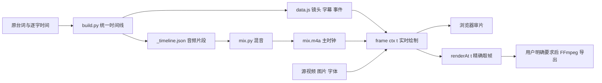

# STEPX 预览工程：实现拆解与下一期复用方法

核对日期：2026-10-19。依据实际代码，不以 README 中未落地的目录为准。原项目参考入口：[剪辑工程](https://github.com/AndroidOne-io/StepXNeoDY/tree/edit-final-20261017/剪辑工程)；本地最新字幕规则为顿号替换成一个空格。

## 1. 为什么改完不必重新渲染整条视频

这里没有把各个镜头先拼成一个 MP4 才播放。播放器读取时间线和素材，浏览器每次刷新画面时执行 `frame(ctx, t)`，把对应时刻的视频帧、图片、字幕和动画画到 Canvas 上。

声音提前混成一条 `mix.m4a`，播放时直接读取 `audio.currentTime` 作为统一时钟。浏览器解码源视频，代码只决定此刻显示哪一帧。因此仍有实时绘制和解码，但省去了每次修改后的整片视频编码。

## 2. 文件分工与复用程度

| 原项目文件 | 实际职责 | 下一期怎么用 |
| --- | --- | --- |
| `网页版/engine.js` | 视频池、播放/跳帧、缓存、Canvas 基础绘制、字幕、透视与效果 | 已提取至本目录，优先复用 |
| `网页版/player.js` | 音轨主时钟、播放暂停、拖动、镜头跳转、逐帧、倍速、renderAt | 已提取，接口保持一致 |
| `网页版/index.html` | 播放器布局、字体、脚本加载顺序 | 已提供去项目依赖的模板 |
| `网页版/sources.js` / `assets.js` | 视频 URL 表与图片列表 | 每期换数据，禁止复用旧素材键值 |
| `网页版/common.js` | 时间查询、出镜映射、片段裁切、项目特效、整帧合成 | 通用方法可参考；配色、手机模型、大标题等不能整份照搬 |
| `网页版/s1.js`–`s4.js` | 每句/每段的具体镜头 | 本期内容，下一期重写；模板用 scenes.js 承接 |
| `代码/lines.py` / `aligned.json` | 原台词和源录音逐字时间 | 保留原始事实，每期重新生成/校对 |
| `代码/build.py` | 源时间到时间线的映射、字幕、关键词事件、生成数据 | 复用思路；补录、停顿与第几句特判是本期配置 |
| `代码/captions.py` | 人工清理显示字幕，同时保持原字时间 | 按规则复用方法，不复制本期字幕文案 |
| `代码/pacing.py` | 删除片段后统一重排口播、字符、镜头和事件 | 可作为可逆剪辑参考；先明确重复短语和边界处理 |
| `代码/mix.py` | 拼口播、统一响度、配乐闪避、按事件放音效 | 音频算法可复用；曲目、源路径、事件表需换成本期数据 |
| `网页版/serve.py` | HTTP Range，让大视频可拖动 | 本目录提供参数化版本，不依赖原项目目录结构 |
| `网页版/tools/export_mp4.py` | 浏览器精确取帧，FFmpeg 编码/拼接 | 本目录提供通用单进程版本，原版保留作并行参考 |
| 本地高清覆盖脚本 | 在 HTTP 层用原片替换同 URL 素材 | 本目录用 .local/media.json 实现，不依赖个人绝对路径 |

公共仓库原有 `工具代码/` 是 Python/OpenCV/PIL 逐帧制作工具，并非浏览器实时引擎。`mix.py` 的 cue 表混音、`own.py`/`own2.py` 的效果思路仍可参考；其中存在 `/tmp/claude-0/` 硬编码路径和历史机器约束，不能当作现代项目的无配置通用模块。本次之前，README 提到的 `网页引擎/` 实际未提交，现在补齐。

## 3. 同一套时间坐标是核心

原工程时间线约定：`t = 成片时间 - PRE`，`PRE` 是片头预留时长。当前片 PRE 为 0。

- `shots`：每句的 `start/end`、口播结束 `vend`、文本、每个字的 `chars` 时间。
- `pieces`：`[源音轨键, 源入点, 源出点, 时间线入点]`，用于拼声音和定位出镜画面。
- `subs`：`[字幕开始, 显示文本, 镜号, 字幕结束]`。
- `EV`：关键词或转场事件的命名时间，例如“联网”“充电”出现时刻。
- `CUTS`：需要转场音效/画面效果的事件名。

源视频时间通常为 `sourceIn + (t - shotStart) × clipRate`。预览倍速只影响推进速度，不能再在画面函数中重复乘一次。字幕、音效、画面事件应通过 `EV` 或逐字时间定位，不散落写死的全片秒数。

剪口播必须改 `pieces` 并更新统一映射：删除区间 `[a,b]` 后，后面的时间整体前移 `b-a`。仅删除字幕不会剪掉声音；仅改镜头长度也不会自动改音轨。

## 4. 实时播放与精确跳帧是两条路径

播放中：播放器用音频时钟驱动画面，视频元素以素材速度 × 预览速度播放，漂移超出阈值时再校正。这样避免每个显示帧都强制 seek 导致抖动。

拖动/逐帧/导出：把视频设为暂停，设置目标 `currentTime`，等待 `seeked/loadeddata`，再重新绘制。`renderAt(t)` 第一遍登记所需视频及时间，等视频准备好后第二遍才取最终画面。暂停过程中仍可能需要重画，不能只 draw 一次就认定完成。

视频缓存用于跳转过程中保留上一张有效画面，减少闪黑；它也可能掩盖解码失败。正式导出应先 probe 素材，对错误显式停止，不用缓存帧代替失败素材。当前参考引擎的等待有超时上限，复杂项目仍需检查切点，不保证所有编码器都逐帧精确。

动画的位置、缩放、透明度根据 `t` 算出；随机效果使用固定种子。不要依赖连续播放累计状态或 `Date.now()`，否则向后拖动和导出结果不同。

## 5. 修改什么，重新生成什么

| 修改内容 | 必要步骤 | 不需要做的步骤 |
| --- | --- | --- |
| 字号、位置、裁切、隐藏购买按钮 | 修改场景 JS，刷新预览 | 不重混、不导出 MP4 |
| 字幕文字、断句、顿号空格 | 更新字幕源，重建 data.js，刷新 | 不重混；原时间保持不变 |
| 只换画面素材、保留声音 | 更新 source/取段或本地映射；必要时重启服务 | 不重混 |
| 删口播、加停顿、调整口播速度 | 重建时间线、字幕和事件，再重混声音 | 不自动导出视频 |
| 改 BGM 音量、音效 | 只重混，刷新音轨 | 不重建无变化的镜头 |
| 需要交付成片 | 用同一服务和 renderAt 导出，核验音画时长 | 不从旧 MP4 再剪一遍 |

原项目具体命令：`python3 剪辑工程/代码/build.py` 只构建数据；加 `audio` 才重建混音；只调配乐可执行 `python3 剪辑工程/代码/mix.py`。模板构建器没有混音功能，不能把模板命令与原项目特有命令混为一谈。

## 6. 高清素材为什么可以只在本地生效

共享代码只认识相对 URL。服务端把这个 URL 映射到本机原片；线上/其他机器没有映射，仍返回仓库素材。因此高清替换不应改 JS 为 `/Users/...`，也不应把便携文件直接覆盖成巨大的原片再提交。

本模板服务支持 Range：普通请求 200、单段字节请求 206、越界 416；后缀范围也处理。视频 seek 会发起 Range 请求，不能只验证首页打开成功。修改映射后重启服务，检查响应头与实际文件。

STEPX 的本地文字清晰化是另一个定制层，用可读文字重绘特定录屏区域；不是自动提高所有素材清晰度的算法。不应默认拿文字重绘覆盖真实操作证据。先分清源片模糊、裁切放大、预览代理、输出分辨率这几个原因。

## 7. 最省重复劳动的开工顺序

1. 阅读剪辑规矩、视频导出约定、本期 README，明确原片、便携素材与交付尺寸。
2. 用 init_project.py 新建预览工程，先确认静音示例可播放、拖动和逐帧。
3. 把本期真实素材和混音接入，核对时长与帧率；正式字体随工程提供。
4. 写本期时间线/转写校对；先完成声音和字幕，保留原始对齐数据。
5. 写 scenes.js；先复用全屏视频、出镜、卡片、字幕等基础组件，再加必要特效。
6. 每次只重建受影响的数据/音轨；按镜头跳转审查，必要时截静帧，不导出测试视频。
7. 提交代码、数据和必要便携资产；不提交 .local 原片、缓存、临时分段和成片。
8. 用户明确要求时再导出；记录使用的代码版本、高清映射、倍速和输出参数。

## 8. 已知成本与限制

- 大部分工程成本来自镜头编排、逐字对齐和素材选择，模板不会自动替代这些判断；它省下播放器、同步机制、服务和导出工具的重复开发。
- 原工程为固定横屏 1080p 逻辑坐标；直接改 Canvas 宽高会影响透视、离屏缓存和文字尺寸，不能声称这样就完成竖屏/原生 2K 适配。
- 多浏览器同时加载全部 4K 素材会增加内存和解码压力，可能启动超时。优先少量并行、保留错误、按需要加载；不要把降清晰度作为默认补救。
- 构建/混音代码包含具体文件名、歌曲和逐句特判。先抽配置，再跨项目复用；不要把上一期的音乐授权和素材授权视为通用授权。
- 本地副本应自包含。删除主仓库会让其关联 worktree 的 Git 元数据和指向主仓库的高清软链接失效；备份预览目录并不等于备份全部依赖。

## 9. 本次验证边界

通过从模板生成新目录，检查数据构建、HTTP Range、本地映射，以及浏览器播放/seek/renderAt 的静帧流程来验证。没有为本次整理导出 MP4。正式导出器保留与原工程相同的取帧/编码路线，增加显式 --speed 和高清检查；本次未对新增导出器做完整视频交付验收。
